# mdgraph

Memory for a repository, kept as plain markdown files.

- One file per thing worth remembering.
- Files link to each other by name.
- The files live on their own `mdgraph` branch, checked out beside the repository.

[`SKILL.md`](SKILL.md) holds the rules a session follows. This file explains the design.



## Start here

1. Run `./install.sh`.
2. Open a Claude Code session. It prints the rules and the graphs on this host.
3. Read a graph with the three commands under [Read a graph](#read-a-graph).
4. Write an entry as one new file, in the format under [An entry](#an-entry).

## An entry

A markdown file with two frontmatter fields:

```markdown
---
description: MGC Tokyo burst fade and continuation — five constructions, none survives a split
date: 2026-08-21
---

Five constructions, train/test split on the 2024-2026 cohort. Best cell reached
t=1.4 in-sample and 0.2 out. The burst itself is real. The direction is not.

- **Source:** src/notebooks/reports/topics/mgc_tokyo/mgc_tokyo.ipynb
- **Relates:** [[mgc-open-one-sided-commitment]]
```

| Part | Rule |
|---|---|
| Filename | It is the entry's identity and its link target. |
| Frontmatter | It is what makes a file an entry. A README at the graph root has none, so it is ignored. There is no directory rule to break. |
| `Source:` | Where the evidence lives outside the graph: a notebook, a file in the repository, a URL. |
| `Relates: [[name]]` | Another entry inside the graph. |
| `[[name]]` | Written only when that entry exists, so a reader can follow any bracket without checking it first. |
| Anything else | A path or plain text. It can be grepped just as well. |

## The four rules of the design

**1. No hierarchy.** Files sit side by side and refer to each other by name.
- A tree gives every entry exactly one home, and a finding does not have one.
- Example: a range-breakout test on gold during Tokyo hours belongs under four topics at once. A tree makes you pick one and hides the entry from the other three.
- Links can point anywhere, and they are exact.

**2. No verdicts.** An entry carries numbers and mechanism. It never pronounces a conclusion.
- Nothing is marked closed.
- A decision is recorded only when you can name who or what made it: a stopping rule declared before the test ran, or the operator's call.
- A session that reads a result and decides the work should stop has not observed a decision. It has made one.

**3. A correction is a new entry.** It links to the entry it corrects.
- The earlier entry stays as written. Knowing what was believed is what makes the correction make sense.

**4. One file per entry.** Two sessions writing at the same time touch different files, so they never collide.

## Read a graph

Three exact commands. There are no embeddings, no similarity search and no query layer.

```bash
grep -rn "<term>" <graph>              # find a word
grep -rl "\[\[<name>\]\]" <graph>      # find what links to an entry
grep -h "^description:" <graph>/*.md   # the whole index
```

- The first command searches entry bodies as well as descriptions.
- The second finds the entries that correct an entry, because a correction links what it corrects.
- Claude Code cuts a command's output past 30,000 characters without warning. For a large graph, filter the index for a topic and never print it whole:

```bash
grep -h "^description:" <graph>/*.md | grep -i <topic>
```

A query tool would not earn its keep. Walking the links returns very little, because most links point at entries nobody has written yet. Whatever a walk would find is already in the index or one `grep -rl` away.

## Why not an extraction engine

An LLM memory engine reads your text, pulls out entities and relations, and stores what it extracted.

| Problem with extraction | What mdgraph does |
|---|---|
| Writing is expensive. On my own corpus, about 26 tokens went out for every token stored. | Your words never pass through a model. |
| Your text does not survive. "NFP killed at tick level, t=0.1–0.6, ZN-only" becomes triples that keep the nouns and drop the number, the threshold and the mechanism. | You decide where one entry ends and the next begins. |
| The engine merges what it stores, so the history is gone. You cannot rebuild the log from the graph. | git keeps the history. |

## Find the graphs on a host

Scan the disk for both kinds of graph:

1. Worktrees on the `mdgraph` branch.
2. Plain `.mdgraph/` directories.

Do not use the registry as the list.
- `~/.claude/mdgraph-registry.txt` records which projects have been asked whether they want a graph. It is not a list of graphs.
- A graph created without a registry line works fine, because the hooks find graphs through git and not through that file.
- Treating the registry as the list fails silently when it is incomplete. You conclude that a project has no memory while the hooks have been indexing its entries all along.

## Install

```bash
./install.sh
```

It does five things:

1. Copies the skill to `~/.claude/skills/mdgraph/`.
2. Copies the four hook scripts to `~/.claude/hooks/`.
3. Registers three of them in `~/.claude/settings.json`, leaving your other hooks alone: `mdgraph-index.sh` on SessionStart, `mdgraph-nudge.sh` on Stop, `mdgraph-guard.sh` on PreToolUse.
4. Creates a plain host graph at `~/.mdgraph` for work that is not about one repository.
5. Adds the host graph's line to the registry.

- The hooks look for repositories under `/root/Projects`. Set `PROJECTS` if yours are elsewhere.
- Files are copied, never symlinked.

## The hooks

A rule only binds a session that has loaded it. The hooks handle what cannot be left to chance.

| Hook | Runs on | What it does |
|---|---|---|
| `mdgraph-index.sh` | SessionStart | Prints the entry rules, then one line per graph on the host. |
| `mdgraph-guard.sh` | PreToolUse | Makes a session read a graph's index before it changes that graph's repository. |
| `mdgraph-nudge.sh` | Stop | Warns when the code has had more commits than the graph has had entries. |
| `mdgraph-resolve.sh` | not registered | Finds a repository's graph. The index and nudge hooks source it, and the guard runs it. |

**`mdgraph-index.sh`**
- Each graph's line shows its name, its entry count, how many of its descriptions run past 200 characters, and its path.
- The whole output is about 500 tokens.
- It prints the rules because a skill's body loads only when a session calls for it, and in practice sessions write entries without ever loading it.
- It prints no graph contents, because a graph is memory for one repository.
- It deletes guard marks older than seven days.

**`mdgraph-guard.sh`**
- The first touch of the repository gets a notice.
- The first write is refused until the session has searched the graph's descriptions.
- Both happen once per repository per session.
- Writing to the graph itself is never held.

**`mdgraph-nudge.sh`**
- For a repository with a graph, it counts the commits made since the last graph entry.
- For a repository with no graph and two or more commits in the last 14 days, it suggests starting one. A `declined` line in the registry silences this for good.

## Convert an existing graph

`scripts/convert-to-entries.py` splits a `WORKLOG.md` graph into one file per entry.

```bash
python3 scripts/convert-to-entries.py <graph>                    # 1. dry run
python3 scripts/convert-to-entries.py <graph> --apply            # 2. write entries, keep logs
python3 scripts/convert-to-entries.py <graph> --apply --remove-log   # 3. remove the logs
```

What the script guarantees:

- It refuses to run on a graph with uncommitted changes, since another session may be halfway through writing.
- Before touching anything, it writes a tarball to `~/backups/mdgraph-preconvert/` and records the commit it started from.
- It reports every `## ` heading it did not convert.
- It leaves the logs in place until you pass `--remove-log`.
- Entries that were already written are recognised and skipped, so step 3 gets to the removal. Keep `--apply` on that run.
- A file that exists with different content makes it stop, so a real name collision can never be overwritten.

**Commit before renaming anything.** New entry files are untracked until the first commit, so `git mv` on one fails with "not under version control". The order:

1. Grep for links to the old name.
2. Commit.
3. Rename.

The index hook reads both formats, so a graph keeps working throughout the conversion.

## License

MIT
